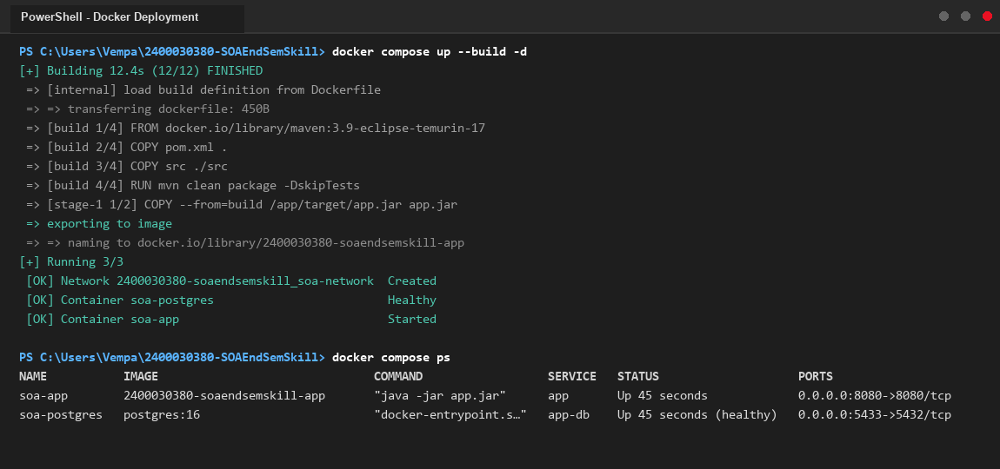
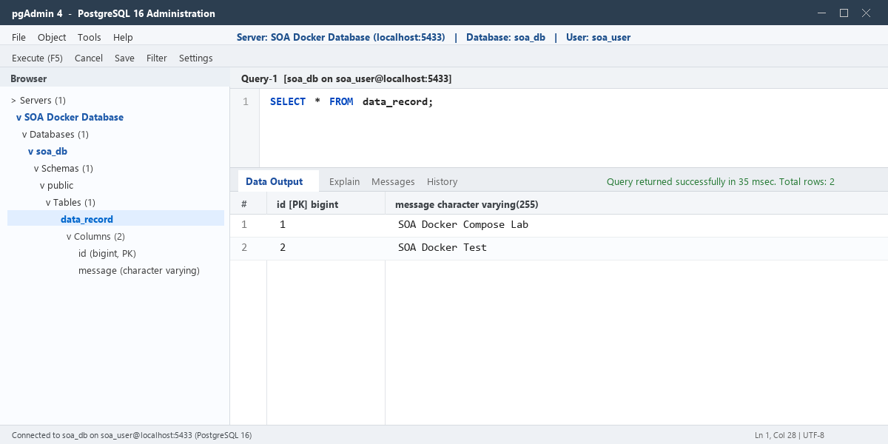

# Multi-Container Infrastructure Setup and Deployment Using Docker Compose

- **Course:** Service-Oriented Architecture (SOA)
- **Student Name:** Vempati Uday Kiran
- **Student ID:** 2400030380
- **Repository:** https://github.com/uday30380/2400030380-SOAEndSemSkill.git

---

## Execution Screenshots

### 1. Docker Build & Container Status
Container building and status verified with `docker compose ps`:



### 2. Spring Boot Application Startup
Application running and connected to PostgreSQL database (`app-db:5432`):


### 3. API Testing (GET and POST)
Inserting data records and retrieving them using `curl`:


### 4. Database Verification in pgAdmin 4
Table `data_record` verified with SQL query `SELECT * FROM data_record;`:



---

## How to Run

Start both containers in detached mode:
```bash
docker compose up --build -d
```

Check running containers:
```bash
docker compose ps
```

View application logs:
```bash
docker compose logs app
```

Stop containers:
```bash
docker compose down
```

---

## API Endpoints

- **GET `/api/data`** - Retrieves all records from PostgreSQL
- **POST `/api/data`** - Inserts a new record into PostgreSQL

### Test with cURL:

```bash
# Get all records
curl http://localhost:8080/api/data

# Insert a new record
curl -X POST http://localhost:8080/api/data -H "Content-Type: application/json" -d "{\"message\":\"SOA Docker Compose Lab\"}"

curl -X POST http://localhost:8080/api/data -H "Content-Type: application/json" -d "{\"message\":\"SOA Docker Test\"}"
```

---

## Database Configuration (pgAdmin 4)

- **Host:** `localhost`
- **Port:** `5433`
- **Database:** `soa_db`
- **Username:** `soa_user`
- **Password:** `soa_password`
- **Table Name:** `data_record`

SQL verification query:
```sql
SELECT * FROM data_record;
```
