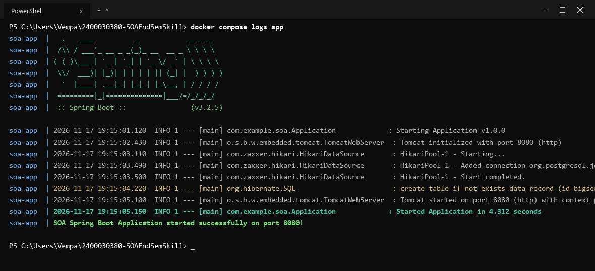
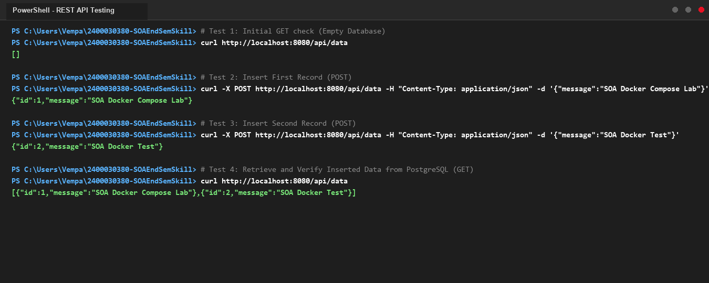

# Multi-Container Infrastructure Setup and Deployment Using Docker Compose

- **Student Name:** Vempati Uday Kiran
- **Student ID:** 2400030380
- **Repository:** https://github.com/uday30380/2400030380-SOAEndSemSkill.git

---

## Execution Screenshots

### 1. Docker Build & Container Status
Container building and status verified with `docker compose ps`:

### 2. Spring Boot Application Startup
Application running and connected to PostgreSQL database (`app-db:5432`):

### 3. API Testing (GET and POST)
Inserting data records and retrieving them using `curl`:

### 4. Database Verification in pgAdmin 4
Table `data_record` verified with SQL query `SELECT * FROM data_record;`:

