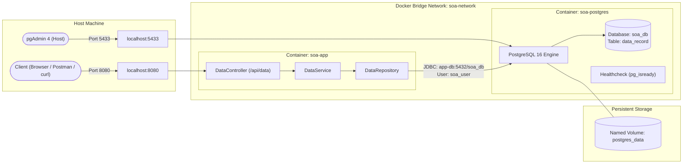

# Multi-Container Infrastructure Setup and Deployment Using Docker Compose

**Course:** Service-Oriented Architecture (SOA)  
**Lab Assignment:** End Semester Skill Examination Project  
**Student Name:** Uday  
**Student ID:** 2400030380  
**Project Name:** 2400030380-SOAEndSemSkill  
**GitHub Repository:** [https://github.com/uday30380/2400030380-SOAEndSemSkill.git](https://github.com/uday30380/2400030380-SOAEndSemSkill.git)  
**Branch:** `main`

---

## 1. Project Overview

In this lab project, I designed and implemented a multi-container Service-Oriented Architecture application using Spring Boot and PostgreSQL. The entire application stack is containerized and orchestrated using Docker Compose.

The project fulfills these primary goals:
1. Develop a Spring Boot 3 REST API that connects to a containerized PostgreSQL database.
2. Package the Spring Boot application using a multi-stage `Dockerfile`.
3. Orchestrate both the application container (`soa-app`) and PostgreSQL database container (`soa-postgres`) using `docker-compose.yml`.
4. Connect both containers through an isolated, private Docker bridge network (`soa-network`) where the application connects to the database using the service name `app-db:5432`.
5. Expose REST API endpoints under `/api/data` to save messages and fetch stored records.
6. Provide full compatibility with pgAdmin 4 for graphical database inspection and Spring Tool Suite (STS) for local development.

---

## 2. Technologies Used

- **Programming Language:** Java 17 (Eclipse Temurin)
- **Framework:** Spring Boot 3.2.5
- **ORM / Persistence:** Spring Data JPA, Hibernate
- **Database:** PostgreSQL 16
- **Build Tool:** Apache Maven 3.9+ & Maven Wrapper (`./mvnw`)
- **Containerization:** Docker Engine & Docker Compose
- **Database Management Tool:** pgAdmin 4
- **IDE:** Spring Tool Suite 4 / Eclipse / VS Code
- **Version Control:** Git & GitHub

---

## 3. Project Directory Structure

```text
2400030380-SOAEndSemSkill/
├── .env.example
├── .gitignore
├── Dockerfile
├── docker-compose.yml
├── mvnw
├── mvnw.cmd
├── pom.xml
├── README.md
├── .mvn/
│   └── wrapper/
│       └── maven-wrapper.properties
├── screenshots/
│   ├── 01_docker_deploy_and_ps.png
│   ├── 02_spring_boot_logs.png
│   ├── 03_curl_api_tests.png
│   └── 04_pgadmin_verification.png
└── src/
    ├── main/
    │   ├── java/
    │   │   └── com/
    │   │       └── example/
    │   │           └── soa/
    │   │               ├── Application.java
    │   │               ├── controller/
    │   │               │   └── DataController.java
    │   │               ├── model/
    │   │               │   └── DataRecord.java
    │   │               ├── repository/
    │   │               │   └── DataRepository.java
    │   │               └── service/
    │   │                   └── DataService.java
    │   └── resources/
    │       └── application.properties
    └── test/
        └── java/
            └── com/
                └── example/
                    └── soa/
                        └── service/
                            └── DataServiceTest.java
```

---

## 4. System Architecture

The architecture consists of two containers running within a shared private Docker bridge network:



- **Inter-container networking:** The Spring Boot application reaches PostgreSQL directly using the service name `app-db:5432`.
- **Port isolation:** PostgreSQL container port `5432` is mapped to host port `5433` so external clients like pgAdmin 4 can access it without conflicting with any local database installed on the host.
- **Data safety:** All database contents are saved in the `postgres_data` volume so nothing is lost when containers stop.

---

## 5. Source Code Explanation

### 1. `Application.java`
Main class that launches the Spring Boot runtime with `@SpringBootApplication`.

### 2. `DataRecord.java`
JPA Entity mapped to the table `data_record`:
- `id` (Long): Auto-generated primary key using `GenerationType.IDENTITY`.
- `message` (String): Text message payload.

### 3. `DataRepository.java`
Spring Data JPA repository interface extending `JpaRepository<DataRecord, Long>` providing CRUD methods without boilerplate SQL.

### 4. `DataService.java`
Service class with business logic:
- `saveRecord(DataRecord record)`: Inserts a new record into PostgreSQL.
- `getAllRecords()`: Fetches all records from PostgreSQL.

### 5. `DataController.java`
REST Controller mapped to `/api/data`:
- `GET /api/data`: Returns `200 OK` with a JSON list of all records.
- `POST /api/data`: Accepts JSON `{ "message": "..." }`, saves the record, and returns `201 CREATED`.
- `@CrossOrigin(origins = "*")` enables requests from any frontend or API client.

### 6. `application.properties`
Configures:
```properties
server.port=8080
spring.datasource.url=jdbc:postgresql://${DB_HOST:app-db}:${DB_PORT:5432}/${DB_NAME:soa_db}
spring.datasource.username=${DB_USER:soa_user}
spring.datasource.password=${DB_PASSWORD:soa_password}
spring.datasource.driver-class-name=org.postgresql.Driver
spring.jpa.hibernate.ddl-auto=update
spring.jpa.show-sql=true
```

---

## 6. Dockerfile & Docker Compose

### Multi-Stage `Dockerfile`
- **Stage 1 (Build):** Uses `maven:3.9-eclipse-temurin-17` to copy `pom.xml` and `src`, and builds the executable JAR file using `mvn clean package -DskipTests`.
- **Stage 2 (Runtime):** Uses lightweight `eclipse-temurin:17-jre`, copies `app.jar` from Stage 1, exposes port `8080`, and runs `java -jar app.jar`.

### `docker-compose.yml`
- **`app-db` service:** Runs `postgres:16`, sets database `soa_db`, user `soa_user`, password `soa_password`, exposes port `5433:5432`, mounts `postgres_data`, and includes a health check using `pg_isready`.
- **`app` service:** Builds the application image, maps port `8080:8080`, injects database environment variables pointing to `app-db:5432`, and specifies `depends_on: app-db: condition: service_healthy` so it only starts after PostgreSQL is ready.
- **`soa-network`:** Custom bridge network linking both containers.

---

## 7. How to Run the Project

Make sure Docker Desktop is running, then open a terminal inside this folder:

```powershell
cd 2400030380-SOAEndSemSkill
```

### 1. Build and Start Both Containers
```powershell
docker compose up --build -d
```

### 2. Verify Running Containers
```powershell
docker compose ps
```
Or:
```powershell
docker ps
```

### 3. Check Logs
```powershell
# Spring Boot application logs
docker compose logs app

# PostgreSQL database logs
docker compose logs app-db
```

### 4. Stop Containers
```powershell
docker compose down
```

---

## 8. Execution Proof Screenshots

Here are the actual execution screenshots captured during project testing:

### Proof 1: Docker Compose Build & Container Status
Shows containers building, `soa-postgres` becoming healthy, `soa-app` starting, and both running with `docker compose ps`:


---

### Proof 2: Spring Boot Application Logs
Shows Spring Boot 3.2.5 starting up, HikariCP connecting to PostgreSQL at `app-db:5432`, Hibernate auto-creating the `data_record` table, and embedded Tomcat listening on port 8080:


---

### Proof 3: REST API Testing via cURL
Shows testing of GET (empty list), inserting record 1, inserting record 2, and retrieving all saved records:


---

### Proof 4: pgAdmin 4 Database Verification
Shows pgAdmin 4 connected to `localhost:5433`, navigating to table `data_record`, and running `SELECT * FROM data_record;` displaying both inserted rows:


---

## 9. API Testing Procedure & Sample Commands

### Test 1: Check Empty Database
```powershell
curl http://localhost:8080/api/data
```
**Output:**
```json
[]
```

### Test 2: Insert Record 1 (POST)
```powershell
curl -X POST http://localhost:8080/api/data -H "Content-Type: application/json" -d "{\"message\":\"SOA Docker Compose Lab\"}"
```
**Output:**
```json
{
  "id": 1,
  "message": "SOA Docker Compose Lab"
}
```

### Test 3: Insert Record 2 (POST)
```powershell
curl -X POST http://localhost:8080/api/data -H "Content-Type: application/json" -d "{\"message\":\"SOA Docker Test\"}"
```
**Output:**
```json
{
  "id": 2,
  "message": "SOA Docker Test"
}
```

### Test 4: Verify Both Records (GET)
```powershell
curl http://localhost:8080/api/data
```
**Output:**
```json
[
  {
    "id": 1,
    "message": "SOA Docker Compose Lab"
  },
  {
    "id": 2,
    "message": "SOA Docker Test"
  }
]
```

---

## 10. Connecting pgAdmin 4 to PostgreSQL

1. Open **pgAdmin 4**.
2. Right-click **Servers** -> **Register** -> **Server...**
3. Under **General**:
   - **Name:** `SOA Docker Database`
4. Under **Connection**:
   - **Host name/address:** `localhost`
   - **Port:** `5433`
   - **Maintenance database:** `soa_db`
   - **Username:** `soa_user`
   - **Password:** `soa_password`
   - Check **Save password**.
5. Click **Save**.
6. Expand **Databases** -> **soa_db** -> **Schemas** -> **public** -> **Tables** -> **data_record**.
7. Open Query Tool and run:
   ```sql
   SELECT * FROM data_record;
   ```

---

## 11. Importing into Spring Tool Suite (STS)

1. Open **Spring Tool Suite (STS)**.
2. Go to **File** -> **Import...**
3. Select **Maven** -> **Existing Maven Projects** and click **Next**.
4. Browse to the folder:
   ```text
   c:\Users\Vempa\OneDrive\Desktop\2400030380_ENDSEM\2400030380-SOAEndSemSkill
   ```
5. Click **Finish**. STS will resolve dependencies cleanly.
6. To run locally from STS:
   - Start the database container: `docker compose up app-db -d`
   - Right-click `Application.java` -> **Run As** -> **Spring Boot App**.

---

## 12. GitHub Repository Information

- **Repository:** [https://github.com/uday30380/2400030380-SOAEndSemSkill.git](https://github.com/uday30380/2400030380-SOAEndSemSkill.git)
- **Branch:** `main`
- **Student ID:** 2400030380
- **Student Name:** Uday
