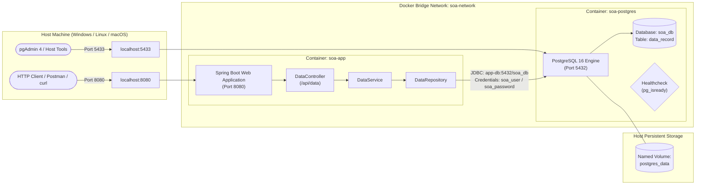

# Multi-Container Infrastructure Setup and Deployment Using Docker Compose

**Subject:** Service-Oriented Architecture (SOA)  
**Student ID:** 2400030380  
**Project Name:** 2400030380-SOAEndSemSkill  
**GitHub Repository:** [https://github.com/uday30380/2400030380-SOAEndSemSkill.git](https://github.com/uday30380/2400030380-SOAEndSemSkill.git)  
**Default Branch:** `main`

---

## 1. Project Objective

The objective of this laboratory examination project is to design, implement, and deploy a distributed multi-container Service-Oriented Architecture (SOA) using **Spring Boot 3.x**, **PostgreSQL 16**, and **Docker Compose**.

Key objectives include:
1. Building a robust RESTful microservice with Spring Boot, Spring Data JPA, and Hibernate.
2. Configuring containerized PostgreSQL with persistent storage and automatic health checking.
3. Setting up a private bridge Docker network (`soa-network`) for secure, isolated inter-container communication using Docker service names (`app-db:5432`).
4. Exposing REST endpoints to insert and retrieve data records from the database.
5. Providing full compatibility with **Spring Tool Suite (STS)** and **pgAdmin 4** database administration.

---

## 2. Technologies Used

| Technology / Tool | Version | Purpose |
| :--- | :--- | :--- |
| **Java** | 17 | Core programming language (LTS) |
| **Spring Boot** | 3.2.5 | Application framework & REST API runtime |
| **Spring Data JPA** | 3.2.5 | Object-Relational Mapping (ORM) and repository layer |
| **Hibernate** | 6.x | JPA implementation & automated schema management (`update`) |
| **PostgreSQL** | 16 | Relational database management system |
| **Apache Maven** | 3.9+ | Build automation and dependency management |
| **Docker Engine & CLI** | 20+ | Containerization platform |
| **Docker Compose** | v2 / v5 | Multi-container orchestration |
| **Spring Tool Suite (STS)** | 4.x | Recommended IDE for development and evaluation |
| **pgAdmin 4** | Latest | Database administration and query execution |
| **Git / GitHub** | Latest | Distributed version control and automation |

---

## 3. Project Folder Structure

```text
2400030380-SOAEndSemSkill/
├── .gitignore
├── .env.example
├── Dockerfile
├── docker-compose.yml
├── pom.xml
├── README.md
└── src/
    ├── main/
    │   ├── java/
    │   │   └── com/
    │   │       └── example/
    │   │           └── soa/
    │   │               ├── Application.java
    │   │               ├── controller/
    │   │               │   └── DataController.java
    │   │               ├── model/
    │   │               │   └── DataRecord.java
    │   │               ├── repository/
    │   │               │   └── DataRepository.java
    │   │               └── service/
    │   │                   └── DataService.java
    │   └── resources/
    │       └── application.properties
    └── test/
        └── java/
            └── com/
                └── example/
                    └── soa/
                        └── service/
                            └── DataServiceTest.java
```

---

## 4. Application Architecture

The system consists of two primary services communicating over an isolated Docker bridge network:



### Architectural Principles:
1. **Separation of Concerns:** Controller (REST endpoints) $\to$ Service (Business Logic) $\to$ Repository (Data Access) $\to$ Database.
2. **Service Name DNS Resolution:** The Spring Boot application reaches PostgreSQL using hostname `app-db` at internal port `5432`.
3. **Port Isolation:** Port `5432` is mapped to host port `5433` exclusively for external client access (e.g., pgAdmin 4), ensuring no conflicts with any locally running PostgreSQL instance on port `5432`.
4. **Data Persistence:** Database files are stored in a dedicated named Docker volume (`postgres_data`), preventing data loss when containers restart or stop.

---

## 5. Spring Boot Implementation

### A. Main Application (`Application.java`)
Configured with `@SpringBootApplication` to trigger component scanning, autoconfiguration, and start the embedded Tomcat container.

### B. Entity Model (`DataRecord.java`)
Maps to the PostgreSQL table `data_record`:
- `id`: Primary key (`Long`), generated automatically using `GenerationType.IDENTITY`.
- `message`: `String` text value holding the payload.

### C. Repository Layer (`DataRepository.java`)
Extends `JpaRepository<DataRecord, Long>`, providing out-of-the-box CRUD operations (`findAll()`, `save()`, `findById()`, etc.) without boilerplate code.

### D. Service Layer (`DataService.java`)
Contains transactional business logic:
- `getAllRecords()`: Fetches all records from PostgreSQL (`@Transactional(readOnly = true)`).
- `saveRecord(DataRecord record)`: Inserts and persists a new record.

### E. REST Controller (`DataController.java`)
Exposes HTTP endpoints under base path `/api/data`:
- `GET /api/data`: Returns `200 OK` with JSON array of all saved records.
- `POST /api/data`: Accepts JSON `{ "message": "..." }`, saves to database, and returns `201 CREATED` with the persisted record.

---

## 6. Dockerfile Explanation

The project uses an optimized **Multi-Stage Dockerfile** to minimize image size and separate the build toolchain from the production runtime:

```dockerfile
# Stage 1: Build Stage
FROM maven:3.9-eclipse-temurin-17 AS build
WORKDIR /app
COPY pom.xml .
COPY src ./src
RUN mvn clean package -DskipTests

# Stage 2: Runtime Stage
FROM eclipse-temurin:17-jre
WORKDIR /app
COPY --from=build /app/target/*.jar app.jar
EXPOSE 8080
ENTRYPOINT ["java", "-jar", "app.jar"]
```

- **Stage 1 (Build):** Compiles Java source files and packages an executable fat JAR using Maven and Temurin JDK 17.
- **Stage 2 (Runtime):** Uses lightweight Eclipse Temurin 17 JRE. Copies only the packaged JAR file, discarding Maven build artifacts, plugins, and cache, resulting in a secure and slim production container.

---

## 7. Docker Compose Configuration

The multi-container architecture is defined in `docker-compose.yml`:

```yaml
services:
  # Database Service (PostgreSQL)
  app-db:
    image: postgres:16
    container_name: soa-postgres
    restart: unless-stopped
    environment:
      POSTGRES_DB: soa_db
      POSTGRES_USER: soa_user
      POSTGRES_PASSWORD: soa_password
    ports:
      - "5433:5432"
    volumes:
      - postgres_data:/var/lib/postgresql/data
    networks:
      - soa-network
    healthcheck:
      test: ["CMD-SHELL", "pg_isready -U soa_user -d soa_db"]
      interval: 10s
      timeout: 5s
      retries: 5
      start_period: 10s

  # Application Service (Spring Boot)
  app:
    build:
      context: .
      dockerfile: Dockerfile
    container_name: soa-app
    restart: unless-stopped
    ports:
      - "8080:8080"
    environment:
      DB_HOST: app-db
      DB_PORT: 5432
      DB_NAME: soa_db
      DB_USER: soa_user
      DB_PASSWORD: soa_password
      SPRING_DATASOURCE_URL: jdbc:postgresql://app-db:5432/soa_db
      SPRING_DATASOURCE_USERNAME: soa_user
      SPRING_DATASOURCE_PASSWORD: soa_password
    depends_on:
      app-db:
        condition: service_healthy
    networks:
      - soa-network

networks:
  soa-network:
    driver: bridge

volumes:
  postgres_data:
    driver: local
```

### Key Highlights:
- **Healthcheck Dependency:** `app` waits until `app-db` is confirmed healthy via `pg_isready` before starting, eliminating race conditions on startup.
- **Service Name Networking:** `app` connects to PostgreSQL at `app-db:5432` on the custom bridge network `soa-network`.

---

## 8. Deployment Commands

Navigate into the project directory:
```bash
cd 2400030380-SOAEndSemSkill
```

### 1. Build and Start Containers (Detached Mode)
```bash
docker compose up --build -d
```

### 2. Verify Running Containers
```bash
docker ps
```
Or check compose status:
```bash
docker compose ps
```

### 3. Inspect Application Logs
```bash
docker compose logs app
```
Or follow logs in real time:
```bash
docker compose logs -f app
```

### 4. Inspect Database Logs
```bash
docker compose logs app-db
```

### 5. Stop Containers (Preserving Data Volume)
```bash
docker compose down
```

---

## 9. API Testing Procedure & Expected Outputs

### Test 1: Container Status Verification
**Command:**
```bash
docker ps
```
**Expected Output:**
```text
CONTAINER ID   IMAGE                               COMMAND                  CREATED         STATUS                   PORTS                    NAMES
a1b2c3d4e5f6   2400030380-soaendsemskill-app       "java -jar app.jar"      1 minute ago    Up 1 minute              0.0.0.0:8080->8080/tcp   soa-app
f6e5d4c3b2a1   postgres:16                         "docker-entrypoint.s…"   1 minute ago    Up 1 minute (healthy)    0.0.0.0:5433->5432/tcp   soa-postgres
```

---

### Test 2: Initial GET Request (Empty Database)
**Endpoint:** `GET http://localhost:8080/api/data`  
**Command:**
```bash
curl http://localhost:8080/api/data
```
**Expected Output:**
```json
[]
```

---

### Test 3: Insert First Data Record (POST)
**Endpoint:** `POST http://localhost:8080/api/data`  
**Header:** `Content-Type: application/json`  
**Command:**
```bash
curl -X POST http://localhost:8080/api/data -H "Content-Type: application/json" -d "{\"message\":\"SOA Docker Compose Lab\"}"
```
**Expected Output:**
```json
{
  "id": 1,
  "message": "SOA Docker Compose Lab"
}
```

---

### Test 4: Insert Second Data Record (POST)
**Endpoint:** `POST http://localhost:8080/api/data`  
**Command:**
```bash
curl -X POST http://localhost:8080/api/data -H "Content-Type: application/json" -d "{\"message\":\"SOA Docker Test\"}"
```
**Expected Output:**
```json
{
  "id": 2,
  "message": "SOA Docker Test"
}
```

---

### Test 5: Verify Retrieved Data (GET)
**Endpoint:** `GET http://localhost:8080/api/data`  
**Command:**
```bash
curl http://localhost:8080/api/data
```
**Expected Output:**
```json
[
  {
    "id": 1,
    "message": "SOA Docker Compose Lab"
  },
  {
    "id": 2,
    "message": "SOA Docker Test"
  }
]
```

---

## 10. pgAdmin 4 Database Connection

To inspect tables and records visually from the host:

1. Open **pgAdmin 4**.
2. Right-click **Servers** $\to$ **Register** $\to$ **Server...**
3. Under the **General** tab:
   - **Name:** `SOA Docker Database`
4. Under the **Connection** tab:
   - **Host name/address:** `localhost`
   - **Port:** `5433`
   - **Maintenance database:** `soa_db`
   - **Username:** `soa_user`
   - **Password:** `soa_password`
   - Check **Save password**.
5. Click **Save**.
6. Expand **Databases** $\to$ `soa_db` $\to$ **Schemas** $\to$ `public` $\to$ **Tables**.
7. Locate the table `data_record`.
8. Open the **Query Tool** and execute:
   ```sql
   SELECT * FROM data_record;
   ```
   **Expected Table Result:**
   | id | message |
   | :--- | :--- |
   | 1 | SOA Docker Compose Lab |
   | 2 | SOA Docker Test |

---

## 11. Spring Tool Suite (STS) Import Instructions

This project is built as a standard Maven project compatible with STS, Eclipse, and IntelliJ IDEA:

1. Launch **Spring Tool Suite (STS)**.
2. Go to **File** $\to$ **Import...**
3. Select **Maven** $\to$ **Existing Maven Projects** and click **Next**.
4. In **Root Directory**, browse to:
   ```text
   c:\Users\Vempa\OneDrive\Desktop\2400030380_ENDSEM\2400030380-SOAEndSemSkill
   ```
5. Ensure `pom.xml` is selected and click **Finish**.
6. Wait for Maven to resolve dependencies and build the workspace.
7. To run the application locally from STS:
   - Start the PostgreSQL container first via `docker compose up app-db -d`.
   - Right-click `Application.java` $\to$ **Run As** $\to$ **Spring Boot App**.

---

## 12. GitHub Repository Information

- **Repository URL:** [https://github.com/uday30380/2400030380-SOAEndSemSkill.git](https://github.com/uday30380/2400030380-SOAEndSemSkill.git)
- **Branch:** `main`
- **Author / Student ID:** 2400030380
- **Username:** `uday30380`
